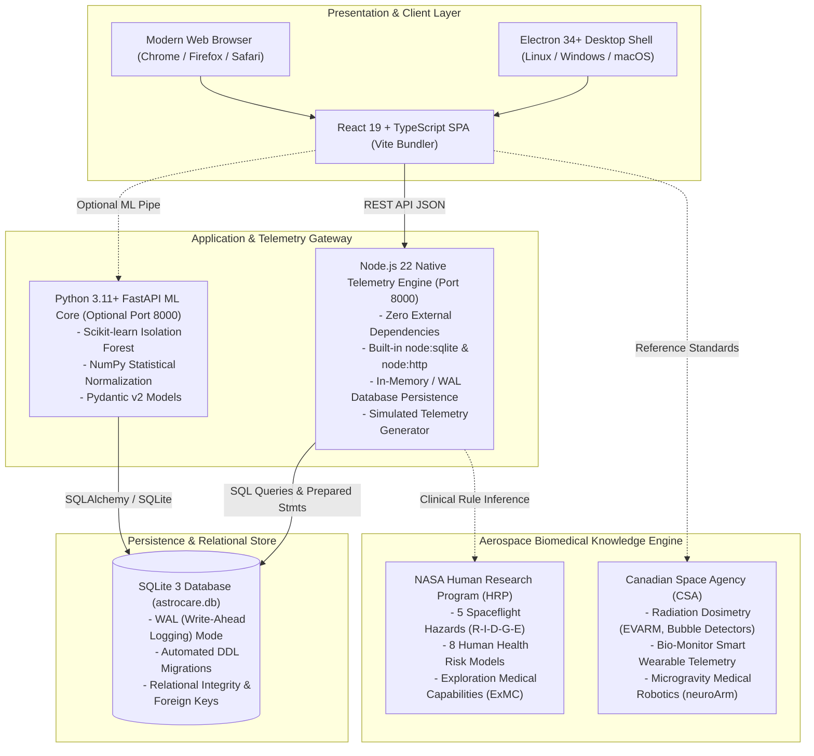
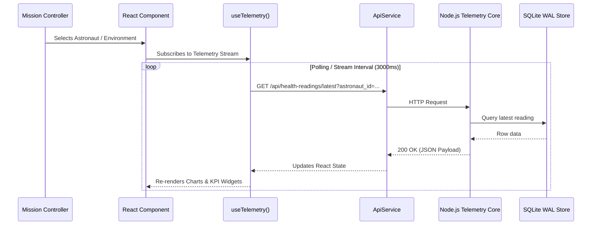
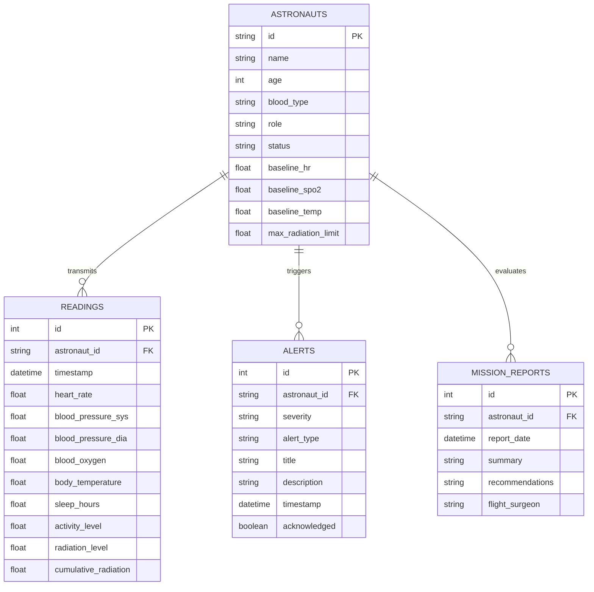
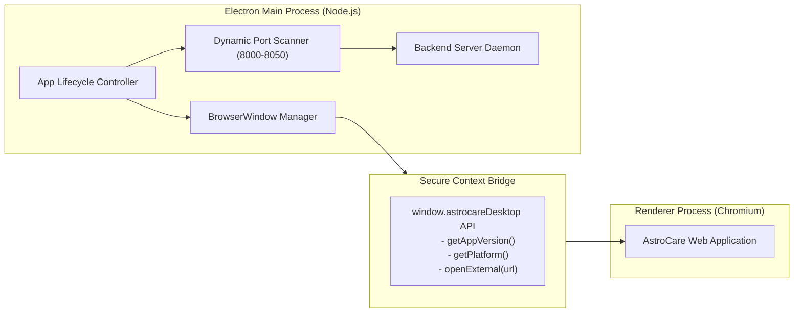

# 🏛️ AstroCare System Architecture & Engineering Specification

> **AstroCare: Astronaut Health Monitoring & Risk Management System**  
> NASA Space Apps Challenge — Enterprise Architecture Specification (v2.0.0)

---

## 1. System Topology Overview

AstroCare utilizes a decoupled, high-performance architecture engineered for both edge-of-orbit autonomy (onboard spacecraft environments with high latency or communication blackouts) and mission control ground stations.



---

## 2. Core Architectural Pillars

### 2.1 Autonomous Edge Computing
In deep-space operations (Moon/Mars transits), round-trip communication delays range from 2.6 seconds (lunar orbit) to 44 minutes (Mars conjunction). AstroCare is built to execute **100% offline**:
- Zero cloud dependencies.
- Local biometric and environmental analysis.
- Onboard heuristic anomaly detection and automated alert triage.

### 2.2 Dual-Compatible Backend Architecture
The repository supports two interchangeable backend execution modes:
1. **Node.js Native Telemetry Core (`backend/server.cjs`)**:
   - Built on Node.js 22 built-in modules (`node:http`, `node:sqlite`, `node:fs`, `node:crypto`).
   - Requires **zero external npm packages** for runtime, enabling ultra-compact distribution (under 1MB executable bundle).
   - Serves both REST API endpoints and static pre-rendered frontend assets in production.
2. **Python FastAPI Backend (`backend/main.py`)**:
   - Python 3.11+ with FastAPI, Uvicorn, Scikit-learn, and NumPy.
   - Houses the Isolation Forest anomaly detection pipeline and scientific data simulation algorithms.

---

## 3. Frontend Architecture

### 3.1 Tech Stack & Build Tooling
- **Framework:** React 19 (Strict Mode)
- **Language:** TypeScript 5.8+ (Strict Type Checking, ESNext target)
- **Build System:** Vite 6 with Rollup code-splitting
- **Data Visualization:** Recharts (responsive multi-temporal SVG charting)
- **Iconography:** Lucide React (aerospace-grade SVG icons)
- **Styling:** Vanilla CSS with custom design tokens (`Orbital Glass` theme)

### 3.2 Code Splitting & Chunk Optimization
Vite bundle optimization splits vendor libraries and route views into separate lazy-loaded chunks:
```
dist/assets/
  ├── index-[hash].js             # Core React & routing runtime (~112 kB gzip)
  ├── vendor-charts-[hash].js     # Recharts and D3 dependencies (~113 kB gzip)
  ├── vendor-icons-[hash].js      # Lucide SVG icon definitions (~11 kB gzip)
  ├── AIInsightsPage-[hash].js    # Anomaly analytics view (~19 kB gzip)
  ├── DashboardOverview-[hash].js # Telemetry live monitoring (~23 kB gzip)
  └── ... (individual route views loaded on demand)
```

### 3.3 State Management & Telemetry Flow


---

## 4. Database Schema & Data Integrity

The SQLite database (`astrocare.db`) uses **WAL (Write-Ahead Logging)** mode with foreign key validation enabled (`PRAGMA foreign_keys = ON;`).

### 4.1 Schema Definition (`database/schemas/001_initial_schema.sql`)
- **`astronauts`**: Crew roster records containing biometric baselines, radiation limits, blood type, and operational status.
- **`readings`**: High-frequency telemetry streams capturing heart rate, blood pressure, SpO₂, core temperature, sleep metrics, and cumulative radiation doses.
- **`alerts`**: Event-driven alert records categorized by severity (`critical`, `warning`, `nominal`) and origin (`physiological`, `environmental`, `hardware`).
- **`mission_reports`**: Formal flight surgeon logs, clinical notes, and mission evaluation summaries.



---

## 5. Desktop Application Architecture

### 5.1 Process Model
AstroCare Desktop is structured with separation between native OS controls and web rendering:



### 5.2 Zero Orphan Process Guarantee
When the desktop window is closed or the user quits:
1. `app.on('before-quit')` intercepts the termination signal.
2. A graceful `SIGTERM` signal is dispatched to the background Node.js server child process.
3. If the backend fails to terminate within 3 seconds, a forceful `SIGKILL` is executed.
4. Process listeners (`exit`, `SIGINT`, `uncaughtException`) ensure no orphaned background servers consume RAM or bind ports.

---

## 6. Security & Hardening

1. **Context Isolation**: Electron renderer runs with `contextIsolation: true` and `nodeIntegration: false`.
2. **CSP (Content Security Policy)**: Restricts script evaluation, disallows inline scripts, and restricts resource fetching to local endpoints.
3. **Prepared Statements**: All SQL queries across Node.js and Python use parameterized prepared statements, preventing SQL injection.
4. **Error Boundary Protection**: React Subsystem Error Boundaries prevent single-component failures from crashing mission telemetry views.

