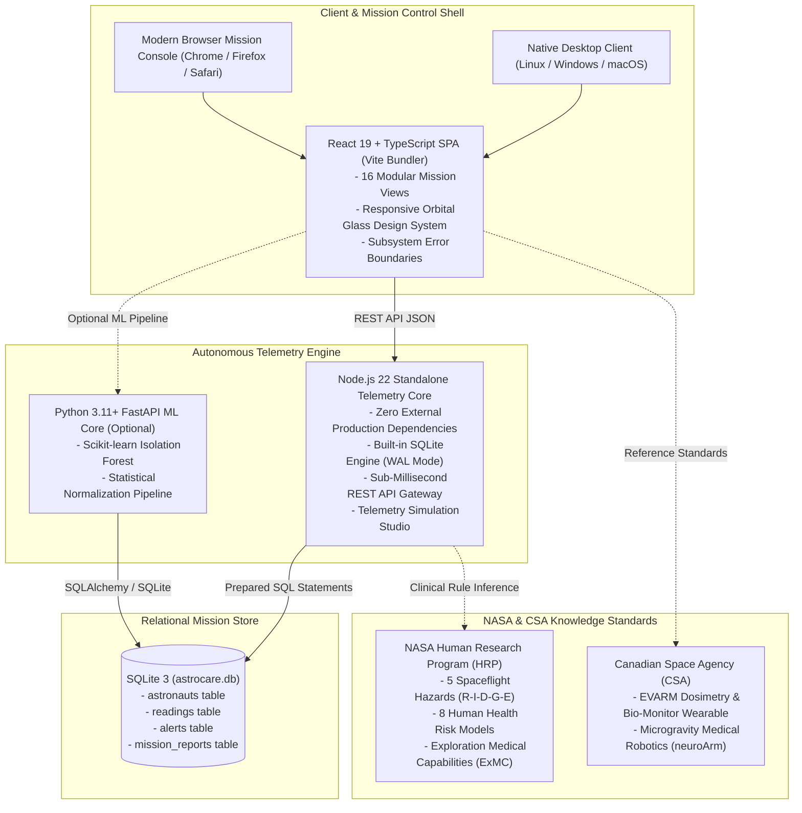

# 🚀 AstroCare — Astronaut Health Monitoring System (AstroVital Intelligence Engine)

<div align="center">


### **Every Heartbeat. Beyond Earth.**
**Autonomous Aerospace Biomedical Telemetry, AI Anomaly Intelligence & Mission Risk Management**

[](CHANGELOG.md)
[](INSTALLATION.md)
[](https://www.spaceappschallenge.org)
[](LICENSE)

*Built by **Team AlgoX** for the **NASA Space Apps Challenge**.*  
*Research Prototype Platform — Designed according to NASA Human Research Program (HRP) Standards.*

</div>

---

## 🛰️ 1. Project Overview & Problem Statement

Astronauts on long-duration exploration missions (e.g., Artemis lunar surface transits and crewed Mars expeditions) encounter prolonged microgravity, cosmic ionizing radiation, acoustic confinement, and isolated habitats. These spaceflight stressors induce cardiovascular deconditioning, cephalad fluid redistribution, circadian disruptions, bone-muscle density loss, and Spaceflight Associated Neuro-ocular Syndrome (SANS).

**AstroCare** is an end-to-end mission intelligence and astronaut physiological health platform engineered to provide:
- **Comprehensive Biometric Monitoring:** Tracks Heart Rate (BPM), Blood Oxygen (SpO₂), Core Body Temperature (°C), Arterial Blood Pressure (mmHg), Sleep Duration & Quality (hrs), Physical Activity (METs), and Cosmic Ionizing Radiation Exposure (μSv/h & cumulative mSv).
- **Measurement Provenance & Integrity:** Classifies every metric as `[MEASURED]`, `[SIMULATED]`, or `[UNAVAILABLE]` to eliminate diagnostic ambiguity in deep-space environments.
- **Multivariate AI Anomaly Detection:** Combines unsupervised machine learning (**Isolation Forest**) with deterministic clinical boundary heuristics aligned with NASA exploration standards.
- **Explainable Anomaly Attribution:** Attributes anomalous deviations directly to contributing factors (e.g., resting tachycardia vs hypoxia vs sensor displacement).
- **Plain-Language Clinical Insights:** Generates actionable, plain-language summaries and recommends targeted countermeasures (ARED resistive exercise, fluid loading, dynamic circadian lighting, storm shelter retreats).
- **Interactive Multi-Temporal Trend Analytics:** Recharts visualization across 24-hour, 7-day, 30-day, and all-mission time horizons with anomaly flag overlays.
- **Alert Triage & Clinical Notes:** Categorizes alerts by severity (*Critical*, *Warning*, *Nominal*) and origin (*Physiological Concern* vs *Sensor Quality Issue*) with flight surgeon review workflows.
- **Crew Profiles & Baselines:** Manages individualized pre-flight medical baselines for each crew member.
- **Mission Health Reports & Data Export:** Automated clinical summaries with 1-click **CSV export** and **Printable / PDF report** formatting.
- **Realistic Telemetry Simulator:** Synthesizes circadian rhythms, microgravity daily workout sessions, and injects targeted anomaly scenarios.
- **Cross-Platform Native Desktop Clients:** Distributed across Linux (`.deb` & portable), Windows (NSIS & portable `.zip`), and macOS (`.app` bundle).

---

## 🏛️ 2. System Architecture



For complete architectural details, see [ARCHITECTURE.md](ARCHITECTURE.md).

---

## 🔬 2.1 NASA & Canadian Space Agency (CSA) Research Integration

AstroCare directly integrates official, peer-reviewed aerospace biomedical research from **NASA's Human Research Program (HRP)** and the **Canadian Space Agency (CSA)**:

1. **NASA Five Major Hazards of Human Spaceflight (R-I-D-G-E)**:
   - **Space Radiation (R)**: Galactic Cosmic Rays (GCRs) and Solar Particle Events (SPEs), biological DNA double-strand breaks, radiation sickness risk, and storm shelters.
   - **Isolation & Confinement (I)**: Small teams in closed habitats, third-quarter phenomenon, dynamic circadian LED lighting, and VR psychological support.
   - **Distance from Earth (D)**: 22-minute communication lag, impossible rapid evacuation, onboard medical autonomy, and ExMC clinical algorithms.
   - **Gravity Fields (G)**: 0-G free-fall, 3-5 G launch/entry, lunar (0.16 G) & Mars (0.38 G) transitions, cephalad fluid shift, 1-1.5% monthly bone loss, SANS, and ARED exercise.
   - **Hostile/Closed Environments (E)**: Recycled air/water, elevated CO2, altered biofilms, lunar/Martian regolith dust toxicity, ECLSS scrubbers, and on-orbit MinION DNA sequencing.

2. **NASA Human Spaceflight Health Risks**:
   - Comprehensive clinical breakdowns for Bone & Muscle Loss, Cardiovascular Remodeling, Vision-related SANS, Immune Dysregulation, Radiation Carcinogenesis, Sleep Disturbances, Psychological Confinement Stress, and Cognitive Adaptation.
   - Strict scientific badges distinguishing established clinical findings from active ongoing research frontiers.

3. **NASA Ongoing Human Research Program (HRP)**:
   - Profiles active research elements (ExMC, HFBP, HHC, ROI, SR) and flagship studies: **CIPHER**, **SPRINT**, **NASA Twins Study follow-ons**, **Food Physiology**, **SANS Countermeasures**, and **Space Flight Standard Measures**.

4. **Canadian Space Agency (CSA) Partner Research**:
   - **Monitoring Radiation for Astronaut Health**: Space radiation mechanics, DNA damage, continuous tracking, and Canadian detection technologies (**EVARM** spacewalk dosimeters, **bubble detectors** for neutrons, **Bio-Monitor** smart shirt).
   - **Microgravity Science**: Absence of sedimentation and convection, macromolecular crystal growth, accelerated biological aging models, and Canadarm spinoffs into **neuroArm** and **IGAR** medical robotics.

5. **Official Resource Center & NASA Disclaimer**:
   - 5 official space agency portals accessible directly with verified external-link indicators.
   - Mandatory NASA Disclaimer: *"NASA does not endorse non-U.S. Government entities. Users visiting external non-U.S. Government websites are responsible for reviewing and following the data-use policies and terms of those websites."*

---

## 🛠️ 3. Technology Stack

| Layer | Technologies | Key Strengths |
| :--- | :--- | :--- |
| **Frontend** | React 19, Vite, TypeScript 5.8+, Recharts, Lucide React | Modular code-splitting, Strict Mode, zero UI freezing |
| **Styling** | Vanilla CSS Design Tokens, Orbital Glass Theme | Dark aerospace palette, high contrast, responsive |
| **Desktop Shell** | Electron 34+, Node.js Native Context Bridge | Cross-platform, zero orphan processes, secure isolation |
| **Backend Core** | Node.js 22 (`node:sqlite`, `node:http`, `node:crypto`) | Zero external npm dependencies, ultra-fast cold start |
| **Alternative ML** | Python 3.11+, FastAPI, Scikit-learn, NumPy, Pandas | Isolation Forest multivariate model, Pydantic v2 |
| **Database** | SQLite 3 with WAL Mode & Auto-Migrations | ACID compliant, embedded, zero configuration |
| **Build & Deploy** | Debian `dpkg-deb`, NSIS, macOS App Bundle | Native `.deb`, Windows setup & portable, macOS `.app` |

---

## 💻 4. Quickstart & Developer Workflow

### Prerequisites
- **Node.js** (v18+, v20+ or v22 recommended)
- **npm** (v9+)
- *(Optional)* Python 3.11+ for Python FastAPI ML experiments

### One-Command Setup & Launch
```bash
# Clone the repository
git clone https://github.com/AlgoX-NASA/AstroCare.git
cd AstroCare

# Install frontend dependencies
npm run --prefix frontend install

# Start both backend and frontend development servers concurrently
npm run dev
```
Open **`http://localhost:5173`** for live development or **`http://localhost:8000`** for production mode.

### Unified Root NPM Commands
```bash
npm run dev              # Concurrent backend + frontend development mode
npm run build            # Compile optimized frontend production assets
npm run typecheck        # Strict TypeScript verification across all modules
npm run lint             # Lightning-fast code linting (oxlint)
npm run test             # Automated verification test suite
npm run desktop          # Run AstroCare in standalone desktop mode
npm run clean            # Purge build caches and temporary packaging folders
```

For complete developer onboarding and standards, see [DEVELOPMENT.md](DEVELOPMENT.md).

---

## 📦 5. Cross-Platform Desktop Installers

AstroCare provides pre-packaged native desktop builds for all major operating systems:

```bash
# Package specific target
npm run package:linux     # Creates .deb and portable .tar.gz in installers/linux/
npm run package:windows   # Creates portable .zip and NSIS installer in installers/windows/
npm run package:mac       # Creates .app bundle and portable .tar.gz in installers/macos/

# Package all platforms in one go
npm run package:all
```

### Installation Summary
- **🐧 Linux (Debian / Ubuntu):**
  ```bash
  sudo dpkg -i installers/linux/astrocare_2.0.0_amd64.deb
  astrocare
  ```
- **🪟 Windows (10 / 11 64-bit):**
  - Extract `installers/windows/AstroCare-2.0.0-Windows-Portable.zip` and run `AstroCare.bat`.
  - Or compile the NSIS installer via `makensis installers/windows/AstroCare-Setup.nsi`.
- **🍎 macOS (Apple Silicon / Intel):**
  - Extract `installers/macos/AstroCare-2.0.0-macOS-Portable.tar.gz` and drag `AstroCare.app` to `/Applications`.

For full step-by-step instructions, see [INSTALLATION.md](INSTALLATION.md).

---

## 📡 6. REST API Endpoints

### Application Health & Crew Profiles
- `GET /api/health` — Subsystem operational status, database health, record counts.
- `GET /api/astronauts` — Crew roster (`CDR Alex Vance`, `Dr. Sarah Chen`, `Marcus Sterling`).
- `GET /api/astronauts/{astronaut_id}` — Individual astronaut profile and authorized medical baselines.
- `PUT /api/astronauts/{astronaut_id}` — Update individualized baseline parameters.

### Telemetry & Analytics
- `GET /api/health-readings` — Paginated telemetry readings with metric and date filters (alias: `/api/readings`).
- `POST /api/health-readings` — Ingest and validate a new physiological reading.
- `GET /api/health-trends?range={24h|7d|30d|all}&astronaut_id={id}` — Multi-temporal Recharts trend analysis with anomaly flags and plain-language insights.
- `GET /api/readings/timeseries?metric={metric}&limit={n}` — Raw time-series points.

### AI Anomaly Detection & Alerts
- `POST /api/analyze?contamination=0.05&limit=500` — Execute Isolation Forest multivariate analysis and generate explainable anomaly attributions.
- `GET /api/anomalies` — List flagged outlier observations with decision scores.
- `GET /api/alerts` — Query alerts filtered by severity (`critical`, `warning`, `info`), type (`health_concern`, `data_quality`), and status (`pending`, `reviewed`, `dismissed`, `escalated`).
- `PATCH /api/alerts/{alert_id}` — Update triage review status and doctor notes.
- `PATCH /api/alerts/{alert_id}/acknowledge` — Quick-acknowledge an alert.

### Reports & Simulator
- `POST /api/reports/generate` — Generate a formal clinical mission health report.
- `GET /api/reports` — List archived mission health reports.
- `GET /api/reports/{report_id}` — Fetch detailed report JSON.
- `GET /api/reports/{report_id}/export/csv` — Download structured CSV medical report.
- `GET /api/simulator/status` — Get simulator engine status.
- `POST /api/simulator/step` — Chronologically generate next 30-min telemetry record with chosen scenario.
- `POST /api/simulator/reset` — Reset database to clean 500-record baseline.

### Authentication
- `POST /api/auth/login` — Authentication gateway for Astronaut or Flight Surgeon roles.
- `GET /api/auth/me` — Get current authenticated user profile.

---

## 🎬 7. Demonstration Workflow for NASA Space Apps Judging

Follow this 3-minute walk-through during project evaluation:

1. **Mission Welcome & Overview (`/`)**:
   - Introduce **AstroCare**: An autonomous aerospace biomedical telemetry and risk management platform for long-duration deep-space transit.
2. **Launch Mission Console (`/dashboard`)**:
   - Header indicators: Active crew member **CDR Alex Vance (ASTRO-01)**, Mission **ARTEMIS-VII**, Sol **142 of 180**.
   - Cabin Environmental Telemetry strip: Cabin O₂ (21.2%), Pressure (101.3 kPa), CO₂ (0.3%).
   - **7 Core Biometric Indicator Cards**: Heart Rate, SpO₂, Core Temp, Blood Pressure, Sleep Duration, Physical Activity, Radiation Dose Rate. Note the strict `[SIMULATED]`, `[MEASURED]`, and `[UNAVAILABLE]` provenance badges.
3. **Health Trend Analytics (`/dashboard/analytics`)**:
   - Toggle between **24 Hours**, **7 Days**, and **30 Days**.
   - Review dashed cyan medical baselines and glowing coral anomaly overlays on the Recharts graph.
   - Point out automated **Statistical Distribution** (Mean, Std Dev, Min/Max) and plain-language clinical insights.
4. **AI Anomaly Detection Studio (`/ai-insights`)**:
   - Adjust the **Contamination Sensitivity** slider and execute **"RUN ISOLATION FOREST"**.
   - Inspect multivariate decision scores, anomaly rate metrics, and targeted clinical countermeasures (ARED exercise, fluid loading, sleep acoustic masking).
5. **Live Simulation & Anomaly Injection (`/dashboard/simulator`)**:
   - Click **"+ Inject Tachycardia"** or **"+ Inject SpO₂ Dip"**.
   - Watch the simulator synthesize the event, persist it to SQLite, and raise an event-driven alert.
6. **Alert Center Triage (`/dashboard/alerts`)**:
   - View the newly generated alert distinguishing **Physiological Concerns** from **Sensor Quality Issues**.
   - Click **"Clinical Review"**, update status to **"Reviewed & Nominal"**, input medical notes, and save.
7. **Mission Health Report Generation & Export (`/dashboard/reports`)**:
   - Generate a NASA-format mission medical assessment for CDR Alex Vance.
   - Demonstrate 1-click **"Export CSV"** and formatted **"Print / PDF Export"**.
8. **NASA & CSA Scientific Research Hub (`/research`)**:
   - Explore the 5 Hazards of Spaceflight (R-I-D-G-E), 8 human health risk breakdowns, Canadian Space Agency radiation dosimetry technologies, and official agency external resources.

---

## ⚖️ 8. Ethical AI & Medical Disclaimer

> **Research Prototype Disclaimer:**  
> AstroCare is an aerospace engineering demonstration and research prototype developed for the NASA Space Apps Challenge.  
> - It is **not** certified by the FDA, NASA, ESA, CSA, or any regulatory body for human clinical diagnostics.  
> - All telemetry values are simulated or synthetic demonstrations and are explicitly labeled as `[SIMULATED]`.  
> - Unsupervised machine learning models (Isolation Forest) detect statistical outliers and must never substitute for licensed flight medical officer judgement.

---

## 📄 9. Documentation Library

- [Architecture Specification](ARCHITECTURE.md)
- [Developer Guide & Contribution Standards](DEVELOPMENT.md)
- [Multi-Platform Installation Guide](INSTALLATION.md)
- [Release Changelog](CHANGELOG.md)
- [Project Documentation Specifications](docs/project/)
- [Presentation Materials](docs/presentation/)

---

<div align="center">

**Team AlgoX • NASA Space Apps Challenge**  
*Advancing Human Health Across the Final Frontier.*

</div>
