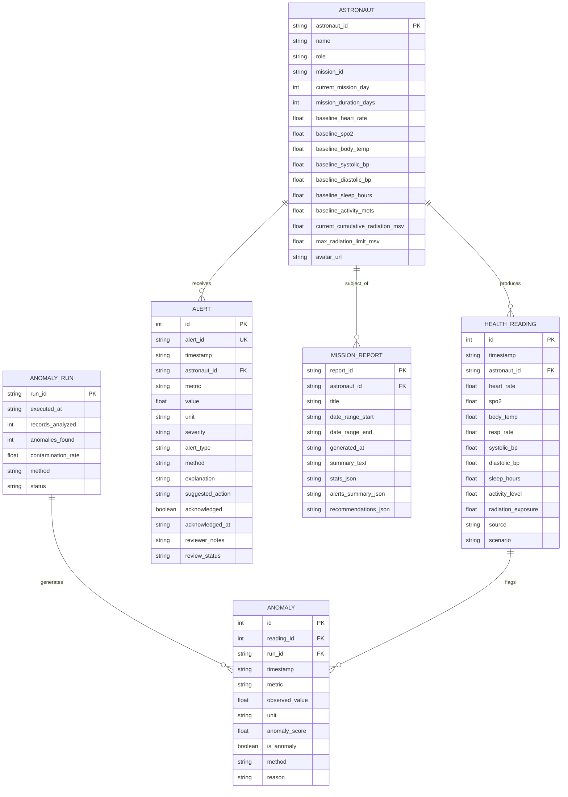

# 05 — Database Design & Schema Specification

---

## 1. Database Architecture Overview

AstroCare utilizes an embedded **SQLite 3** relational database managed via **SQLAlchemy 2.0 ORM** and configured through `backend/app/core/database.py`. SQLite was selected for its zero-configuration footprint, deterministic operational behavior, and low memory consumption on resource-constrained exploration spacecraft computers.

---

## 2. Entity-Relationship Model

---

## 3. Detailed Table Dictionaries

### Table: `astronauts`
| Column | Type | Constraints | Description |
| :--- | :--- | :--- | :--- |
| `astronaut_id` | VARCHAR(32) | PRIMARY KEY | Unique astronaut crew identifier (e.g. `ASTRO-01`). |
| `name` | VARCHAR(128)| NOT NULL | Crew member full name. |
| `role` | VARCHAR(64) | NOT NULL | Mission assignment role (e.g. `Mission Commander`). |
| `mission_id` | VARCHAR(32) | NOT NULL | Expedition identifier (e.g. `ARTEMIS-VII`). |
| `current_mission_day`| INTEGER | NOT NULL | Current flight sol counter. |
| `mission_duration_days`| INTEGER | NOT NULL | Total scheduled flight duration. |
| `baseline_heart_rate`| FLOAT | NOT NULL | Pre-flight resting heart rate (bpm). |
| `baseline_spo2` | FLOAT | NOT NULL | Pre-flight arterial oxygen saturation (%). |
| `baseline_body_temp` | FLOAT | NOT NULL | Pre-flight resting core body temperature (°C). |
| `baseline_systolic_bp`| FLOAT | NOT NULL | Pre-flight resting systolic arterial pressure (mmHg).|
| `baseline_diastolic_bp`| FLOAT | NOT NULL | Pre-flight resting diastolic arterial pressure (mmHg).|
| `current_cumulative_radiation_msv` | FLOAT | NOT NULL | Mission cumulative ionizing radiation dose (mSv). |
| `max_radiation_limit_msv` | FLOAT | NOT NULL | NASA career permissible radiation limit (mSv). |

### Table: `health_readings`
| Column | Type | Constraints | Description |
| :--- | :--- | :--- | :--- |
| `id` | INTEGER | PRIMARY KEY AUTOINCREMENT | Unique sequence identifier. |
| `timestamp` | DATETIME | NOT NULL, INDEXED | ISO 8601 reading timestamp. |
| `astronaut_id` | VARCHAR(32) | FOREIGN KEY, INDEXED | Associated crew member ID. |
| `heart_rate` | FLOAT | NULLABLE | Instantaneous heart rate reading (bpm). |
| `spo2` | FLOAT | NULLABLE | Pulse oximetry oxygen saturation (%). |
| `body_temp` | FLOAT | NULLABLE | Core body temperature (°C). |
| `resp_rate` | FLOAT | NULLABLE | Breath frequency (br/min). |
| `systolic_bp` | FLOAT | NULLABLE | Systolic blood pressure (mmHg). |
| `diastolic_bp` | FLOAT | NULLABLE | Diastolic blood pressure (mmHg). |
| `radiation_exposure`| FLOAT | NULLABLE | Ambient dosimeter rate (mSv/day). |
| `source` | VARCHAR(32) | NOT NULL | Data provenance (`sensor`, `import`, `simulated`).|

### Table: `alerts`
| Column | Type | Constraints | Description |
| :--- | :--- | :--- | :--- |
| `id` | INTEGER | PRIMARY KEY AUTOINCREMENT | Internal table sequence key. |
| `alert_id` | VARCHAR(64) | UNIQUE, NOT NULL | Public alphanumeric alert ID (e.g. `ALT-CRIT-01`).|
| `timestamp` | DATETIME | NOT NULL | Excursion trigger timestamp. |
| `severity` | VARCHAR(16) | NOT NULL | Severity classification (`critical`, `warning`, `info`).|
| `alert_type`| VARCHAR(32) | NOT NULL | Category (`health_concern`, `data_quality`). |
| `explanation`| TEXT | NOT NULL | Plain-language clinical explanation. |
| `acknowledged`| BOOLEAN | DEFAULT FALSE | Acknowledgment state flag. |
| `review_status`| VARCHAR(24) | NOT NULL | Status (`pending`, `reviewed`, `dismissed`, `escalated`).|

